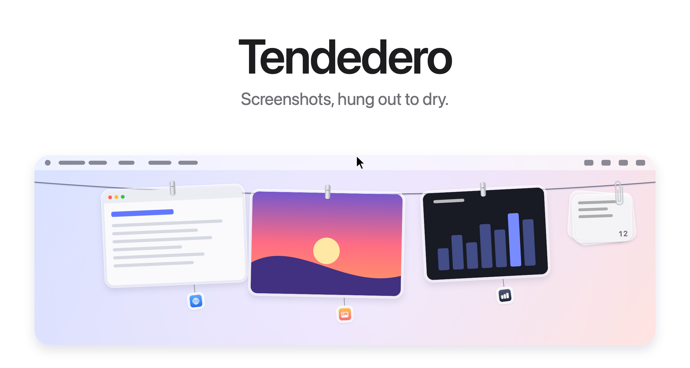
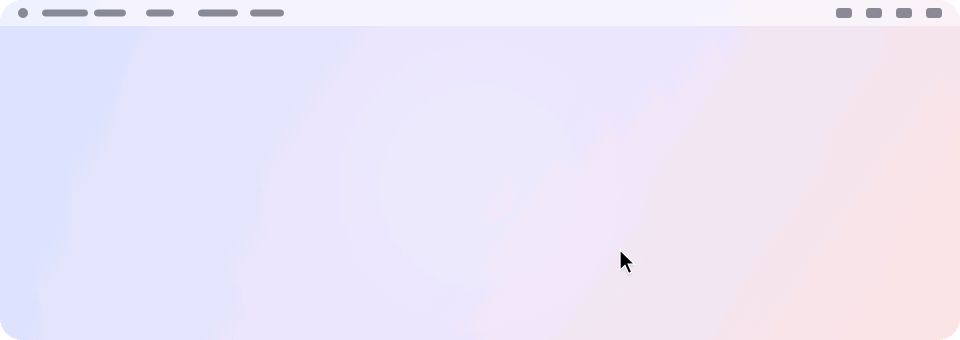
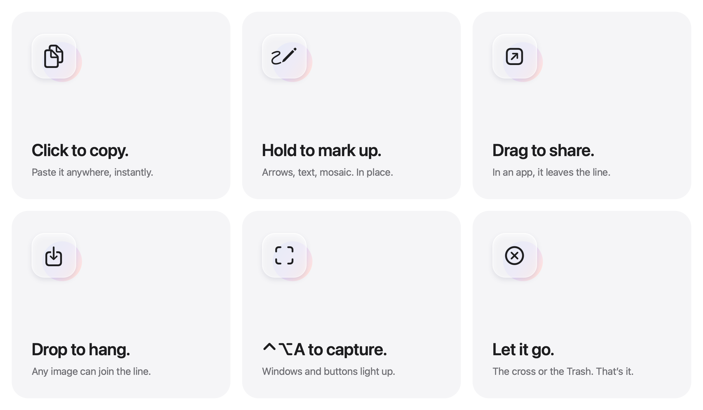
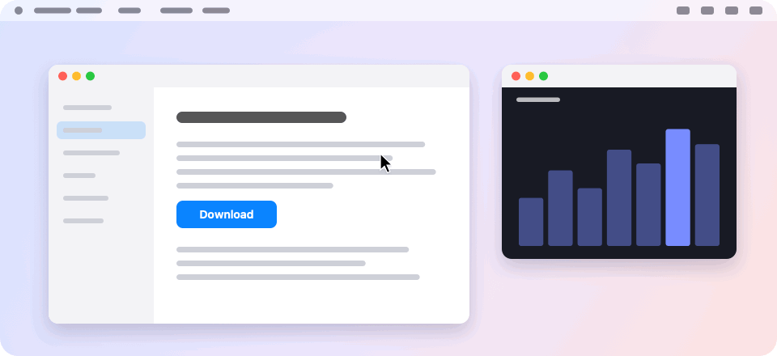
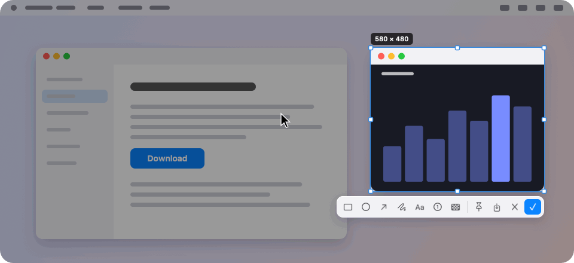
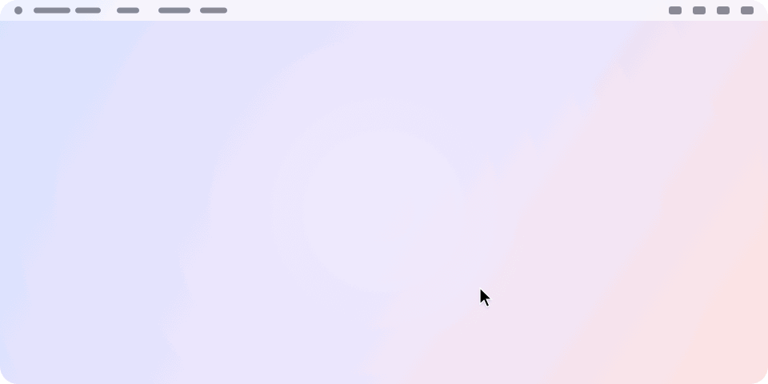

<picture>
  <source media="(prefers-color-scheme: dark)" srcset="../images/hero-dark.png">
  
</picture>

<h3 align="center"><a href="../../../../releases/latest">Download the latest release&nbsp;&rsaquo;</a></h3>

<p align="center">
  Free and open source. For macOS 14 and later.
  <br>
  Grown from <a href="https://github.com/alejandrobujan/tendedero">Tendedero</a> by Alejandro Buján, with its own screenshot tool, markup, notes and more.
  <br>
  <a href="#build-from-source">Build from source&nbsp;&rsaquo;</a>
  <br><br>
  English&nbsp;·&nbsp;<a href="../../README.md">简体中文</a>
</p>

<br>

## Out of sight. Within reach.

Every screenshot you take hangs on a line just above your screen.
Rest the pointer in the middle of the menu bar and it glides down. Move away and it's gone.

<picture>
  <source media="(prefers-color-scheme: dark)" srcset="../images/demo-dark.gif">
  
</picture>

<br>
<br>

## A gesture for everything.

<picture>
  <source media="(prefers-color-scheme: dark)" srcset="../images/bento-dark.png">
  
</picture>

<br>
<br>

| | |
|:--|:--|
| Click | Copy the image. |
| Press and hold | Mark it up: arrows, shapes, text, numbers, mosaic. |
| Double click | Open it in Preview. |
| Force click | Take a quick look. |
| Right click | Pin it to the screen, open it in the system's Markup, save it to the Desktop, and more. |
| Drag into an app | Send it. It leaves the line; a screenshot in Clipline's folder goes to the Trash a few minutes later. |
| Drag into a folder | Keep it there. It leaves the line. |
| Drag to the Trash, or click the cross | Let it go. |
| Hold and sweep along the line | Like scissors through the clips: every photo it passes falls. Undo for a few seconds. |
| Drag an image onto the line | Hang it. The photos make room as you carry it. |
| Rest the pointer in the middle of the menu bar | Bring the line down on that screen. |
| Click anything in the menu bar | Put it away. |
| <kbd>⌃</kbd>&thinsp;<kbd>⌥</kbd>&thinsp;<kbd>T</kbd> | Show or hide the line. |
| <kbd>⌃</kbd>&thinsp;<kbd>⌥</kbd>&thinsp;<kbd>A</kbd> | Take a screenshot. Both shortcuts change under Shortcut in the menu bar. |

<br>

## A screenshot tool of its own.

Press <kbd>⌃</kbd>&thinsp;<kbd>⌥</kbd>&thinsp;<kbd>A</kbd> and the screen freezes. The window under the
pointer lights up: click to take it. Drag instead, and the edges stick to
windows as you go, with a magnifier for the last pixel and its color a key
away.

<picture>
  <source media="(prefers-color-scheme: dark)" srcset="../images/capture-dark.gif">
  
</picture>

Allow Accessibility<sup>2</sup> and it goes further: the button, sidebar or
text field under the pointer lights up on its own. Scroll to step out to
what holds it.

Mark it up right where it is, on a glass toolbar under the selection. Color
each word of a text as you like, and scroll to make lines thicker or
thinner. Return copies it and hangs it on the line.

<picture>
  <source media="(prefers-color-scheme: dark)" srcset="../images/markup-dark.gif">
  
</picture>

<br>

## Your Desktop. Finally clear.

Hand Clipline your screenshots<sup>1</sup> and they skip the Desktop
entirely. No floating thumbnail. No five-second wait. Each capture hangs
the instant you take it, and only what you drag out is kept.

Screen recordings hang there too, with a play button over them.
Press and hold one to trim it.

Same shortcuts. Same muscle memory. Just less mess.

<br>

## Where it came from.

A small tag hangs under each photo with the icon of the app it was taken
in. Point at it to read the app and the window. Show the name, only the
icon, or nothing, under Source tags in the menu bar.

<br>

## Copied images, and copied text.

Take a screenshot with <kbd>⌃</kbd> held, or copy an image in Preview, and it
hangs on the line like any other. Turn on Hang copied images in the menu bar.

Text you copy goes into a clip of glass notes at the end of the line,
without bringing it down. Click the clip to find any of them again, and
keep the ones you need at the top.

<picture>
  <source media="(prefers-color-scheme: dark)" srcset="../images/notes-dark.gif">
  
</picture>

Anything a password manager marks as private is left alone.

<br>

## Private by design.

No account. No network. No analytics.
Clipline runs entirely on your Mac, and your screenshots never leave it.

<br>

## Tech Specs

| | |
|:--|:--|
| **Compatibility** | macOS 14 Sonoma or later, on Apple silicon and Intel. Designed for macOS 27. |
| **Size** | About 5 MB |
| **Languages** | English and Simplified Chinese. Spanish, French, Portuguese (Brazil), Japanese, Korean, Turkish and Azerbaijani for what came from Tendedero. |
| **Built with** | Swift, AppKit and SwiftUI |
| **Network access** | None |
| **Price** | Free |
| **License** | MIT for the code. The name and icon are not included. |

<br>

## Install

With [Homebrew](https://brew.sh):

```sh
brew install --cask ffkiyo7/tap/clipline
```

Or download the app from the [latest release](../../../../releases/latest) and
drag it to Applications.

The release is not notarized by Apple, so macOS stops it the first time.
Run this once, then open it as usual:

```sh
xattr -dr com.apple.quarantine /Applications/Clipline.app
```

Or open it, then choose Open Anyway under System Settings → Privacy &
Security. Homebrew upgrades with `brew upgrade --cask clipline` open right
away.

Coming from Tendedero? Quit it first. Clipline brings over its settings,
the photos on the line and the copied text. macOS asks once more for Screen
Recording and Accessibility, since to macOS it is a new app.

<br>

## Build from source

```sh
git clone https://github.com/ffkiyo7/Clipline.git
cd Clipline
scripts/build-app.sh
open build/Clipline.app
```

Requires the Swift toolchain. Xcode is optional. `swift test` runs the tests, which need the XCTest that comes with Xcode. The end-to-end tests drive the real keyboard and mouse, so they only run when asked: build with `scripts/build-app.sh`, quit Clipline, give the terminal Accessibility access, then run `CLIPLINE_E2E=1 swift test --filter CliplineE2ETests`. With the Command Line Tools for macOS 27, the script falls back to the macOS 26 SDK they install alongside, because the new SDK needs a SwiftUI macro plugin only Xcode includes.

Local builds are signed with your Apple Development certificate when you
have one, the one Xcode makes for any Apple ID, so macOS remembers the
Screen Recording and Accessibility access across rebuilds. Without one
they are signed ad hoc, and macOS asks again after each rebuild.

<details>
<summary>Inside the app</summary>
<br>

| File | Role |
|:--|:--|
| `AppDelegate.swift` | Menu bar, shortcuts, revealing and tucking away the line |
| `LinePanel.swift` | The transparent strip along the top of the screen |
| `LineView.swift` | The line and where each photo hangs |
| `LineDrop.swift` | Images dropped on the line |
| `PeggedView.swift` | One photo: glass frame, clip, source tag, swing and breeze |
| `GrabArea.swift` | Click, long press, drag and drop |
| `Line.swift` | What is hanging, and what you can do with it |
| `Capture.swift` | The screenshot tool: selection, magnifier, toolbar |
| `Elements.swift` | Buttons and panels under the pointer, through Accessibility |
| `Editor.swift`, `EditorCanvas.swift`, `EditorMarks.swift` | Markup: tools, marks and how they are drawn |
| `Pin.swift` | Photos pinned to the screen |
| `Source.swift` | Which app and window a screenshot came from |
| `Notes.swift`, `NoteClip.swift`, `NotesPanel.swift` | Copied text and the clip that holds it |
| `ScreenshotWatcher.swift` | Notices new screenshots |
| `ClipboardWatcher.swift` | Notices images and text copied to the clipboard |
| `Inbox.swift` | Takes over screenshot settings and puts them back |
| `HotKey.swift` | The keyboard shortcuts |
| `Shortcuts.swift` | The two global shortcuts, and the window that changes them |
| `Markup.swift` | Opens the system Markup editor and saves the result |
| `Trim.swift` | Trims a screen recording and saves the result |
| `FullScreen.swift` | Knows when to stay hidden |
| `Welcome.swift` | The welcome on first launch: short scenes acting out each feature |

Every image here, the icon included, is drawn in code by
`scripts/make-icon.swift` and `scripts/make-readme-art.swift`.
`scripts/make-dmg.sh` builds the disk image for releases.

Translations live in `Sources/Clipline/Resources`, one `.lproj` folder per
language. `swift scripts/check-strings.swift` checks that none is missing.

</details>

<br>

---

<sub>
1. On first launch, Clipline offers to handle your screenshots. If you accept, it turns off the floating thumbnail and saves new screenshots to its own folder, two settings also found under Options in Cmd+Shift+5. Your previous settings are saved and restored when Clipline quits or the option is turned off from the menu bar. Clipline hides automatically while an app is in full screen.
<br><br>
2. Turn on Find Buttons and Panels in Screenshots in the menu bar, then allow Clipline under System Settings → Privacy & Security → Accessibility. Without it, screenshots still find whole windows. Taking screenshots needs Screen Recording access.
</sub>

<br>
<br>

<p align="center">
  
  <br>
  <sub>The code is MIT licensed. Clipline started from Tendedero’s code; the Tendedero name and icon are not part of it. See <a href="../../LICENSE">LICENSE</a>.</sub>
  <br>
  <sub>Clipline is made by <a href="https://github.com/ffkiyo7">ffkiyo7</a>, from <a href="https://github.com/alejandrobujan/tendedero">Tendedero</a> by <a href="https://alejandrobujan.com">Alejandro Buján</a>.</sub>
</p>
