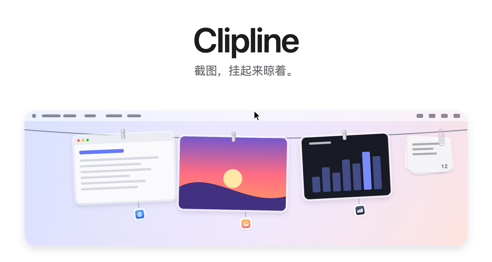
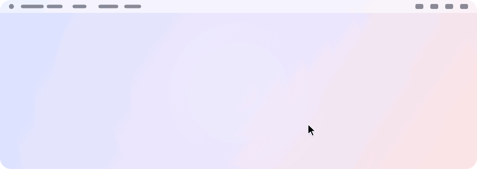
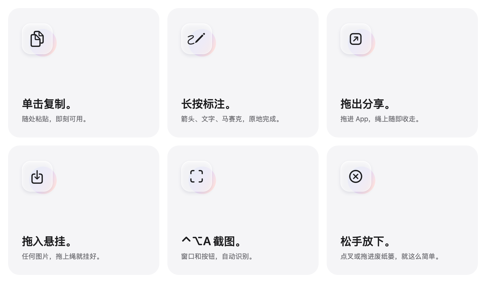
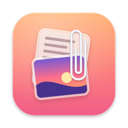

<picture>
  <source media="(prefers-color-scheme: dark)" srcset="../images/zh-Hans/hero-dark.png">
  
</picture>

<h3 align="center"><a href="../../../../releases/latest">下载最新版本&nbsp;&rsaquo;</a></h3>

<p align="center">
  免费开源。适用于 macOS 14 及以上。
  <br>
  从 Alejandro Buján 的 <a href="https://github.com/alejandrobujan/tendedero">Tendedero</a> 发展而来，加入了自己的截图工具、标注、文字夹等功能。
  <br>
  <a href="#从源码构建">从源码构建&nbsp;&rsaquo;</a>
  <br><br>
  <a href="../../README.md">English</a>&nbsp;·&nbsp;简体中文
</p>

<br>

## 看不见，却够得着

你每截一张图，它都会挂到屏幕顶上的一根绳上。
把指针停在菜单栏中间，绳子就滑下来；移开，它就收起。

<picture>
  <source media="(prefers-color-scheme: dark)" srcset="../images/zh-Hans/demo-dark.gif">
  
</picture>

<br>
<br>

## 每个动作都有手势

<picture>
  <source media="(prefers-color-scheme: dark)" srcset="../images/zh-Hans/bento-dark.png">
  
</picture>

<br>
<br>

| | |
|:--|:--|
| 单击 | 复制这张图。 |
| 长按 | 标注：箭头、形状、文字、序号、马赛克。 |
| 双击 | 用「预览」打开。 |
| 用力点按 | 用「快速查看」看一眼。 |
| 右键 | 贴到屏幕上、用系统「标记」打开、存到桌面等。 |
| 拖进 App | 发送过去。照片从绳上收走；如果是 Clipline 文件夹里的截图，几分钟后移到废纸篓。 |
| 拖进文件夹 | 存在那儿。原图从绳上取下。 |
| 拖到废纸篓，或点叉 | 松手丢弃。 |
| 把图片拖到绳上 | 挂上去。拖着经过时，其他照片会让出位置。 |
| 指针停在菜单栏中间 | 在那一块屏幕上放下绳子。 |
| 点击菜单栏任意处 | 把绳子收起来。 |
| <kbd>⌃</kbd>&thinsp;<kbd>⌥</kbd>&thinsp;<kbd>T</kbd> | 显示或隐藏绳子。 |
| <kbd>⌃</kbd>&thinsp;<kbd>⌥</kbd>&thinsp;<kbd>A</kbd> | 截图。两个快捷键都可以在菜单栏的「快捷键」中更改。 |

<br>

## 自带截图工具

按 <kbd>⌃</kbd>&thinsp;<kbd>⌥</kbd>&thinsp;<kbd>A</kbd>，屏幕定格。指针下的窗口会亮起来，单击就截下它。
也可以拖出一块区域，边缘会自动吸附到窗口边上；放大镜帮你对准最后一个像素，按一下键就能复制那里的颜色。

打开辅助功能权限<sup>2</sup>后还能更进一步：指针下的按钮、侧边栏、输入框会自己亮起来。滚动滚轮，一层层扩到包住它的区域。

选好之后就在原地标注，工具栏是一块浮在选区下方的玻璃。文字里每个字都可以换颜色，滚轮可以调线条粗细。按回车复制，同时挂到绳上。

<br>

## 桌面，终于清爽了

把截图交给 Clipline<sup>1</sup>，它们就完全跳过桌面。
没有浮动缩略图。不用等五秒。拍下的瞬间即挂上绳，只有你拖出去的才会留下。

屏幕录制也会挂上绳，上面带一个播放按钮。按住即可剪辑。

同样的快捷键。同样的肌肉记忆。只是少了乱。

<br>

## 从哪儿来的，一眼就知道

每张照片下面挂着一个小标签，显示截图时所在 App 的图标。指针移上去，能看到 App 名和窗口标题。
在菜单栏的「来源吊牌」里，可以选显示名称、只显示图标，或者不显示。

<br>

## 复制的图片和文字

按住 <kbd>⌃</kbd> 截图，或在「预览」中复制图片，它就会像其他截图一样挂上绳。在菜单栏中打开「挂上复制的图片」即可。

复制的文字会收进绳尾的一个夹子，像一叠玻璃便签，不会把绳子叫下来。点夹子就能搜索翻找，常用的可以置顶。

密码管理器标为私密的内容，一律不记录。

<br>

## 隐私是设计前提

没有账号。不联网。无统计。
Clipline 完全在你的 Mac 上运行，截图不会离开这台电脑。

<br>

## 技术规格

| | |
|:--|:--|
| **兼容性** | macOS 14 Sonoma 及以上，Apple 芯片与 Intel 均支持。已针对 macOS 27 设计。 |
| **体积** | 约 5 MB |
| **语言** | 英语、简体中文。原版 Tendedero 已有的部分另有西班牙语、法语、巴西葡萄牙语、日语、韩语、土耳其语、阿塞拜疆语。 |
| **技术栈** | Swift、AppKit 与 SwiftUI |
| **网络访问** | 无 |
| **价格** | 免费 |
| **许可** | 代码为 MIT。名称与图标不在授权范围内。 |

<br>

## 安装

从[最新版本](../../../../releases/latest)下载 App，拖进「应用程序」。

这个版本没有经过 Apple 公证。第一次打开时，按住 Control 点按 App 再选「打开」，或者在「系统设置 → 隐私与安全性」里允许它。

之前用过 Tendedero？先退出它。Clipline 会带过来它的设置、绳上的照片和复制的文字。对 macOS 来说这是个新 App，所以屏幕录制和辅助功能权限要再授权一次。

<br>

## 从源码构建

```sh
git clone https://github.com/ffkiyo7/Clipline.git
cd Clipline
scripts/build-app.sh
open build/Clipline.app
```

需要 Swift 工具链，Xcode 可选。若使用 macOS 27 的命令行工具，脚本会回退到随其一同安装的 macOS 26 SDK，因为新版 SDK 需要只有 Xcode 才带的 SwiftUI 宏插件。

如果你有 Apple Development 证书（任何 Apple ID 在 Xcode 里都能生成），本地构建会用它签名，重新构建后 macOS 仍然记得屏幕录制和辅助功能权限。没有的话采用 ad-hoc 签名，每次重新构建都要重新授权。

<details>
<summary>应用内部</summary>
<br>

| 文件 | 作用 |
|:--|:--|
| `AppDelegate.swift` | 菜单栏、快捷键、放下与收起绳子 |
| `LinePanel.swift` | 屏幕顶部那条透明的窄条 |
| `LineView.swift` | 绳子本身，以及每张照片挂在哪里 |
| `LineDrop.swift` | 拖到绳上的图片 |
| `PeggedView.swift` | 一张照片：玻璃相框、夹子、来源标签、摇摆与微风 |
| `GrabArea.swift` | 单击、长按、拖放 |
| `Line.swift` | 绳上挂着什么，以及你能对它做什么 |
| `Capture.swift` | 截图工具：选区、放大镜、工具栏 |
| `Elements.swift` | 通过辅助功能找到指针下的按钮和面板 |
| `Editor.swift`、`EditorCanvas.swift`、`EditorMarks.swift` | 标注：工具、标记以及它们的画法 |
| `Pin.swift` | 贴在屏幕上的照片 |
| `Source.swift` | 截图来自哪个 App、哪个窗口 |
| `Notes.swift`、`NoteClip.swift`、`NotesPanel.swift` | 复制的文字，以及装它们的夹子 |
| `ScreenshotWatcher.swift` | 发现新的截图 |
| `ClipboardWatcher.swift` | 发现复制到剪贴板的图片和文字 |
| `Inbox.swift` | 接管截图设置，之后再把它们放回去 |
| `HotKey.swift` | 键盘快捷键 |
| `Markup.swift` | 打开系统「标记」编辑器并保存结果 |
| `Trim.swift` | 剪辑屏幕录制并保存结果 |
| `FullScreen.swift` | 判断何时该保持隐藏 |

这里出现的每一张图——包括图标——都是由代码绘制的：
`scripts/make-icon.swift` 与 `scripts/make-readme-art.swift`。
`scripts/make-dmg.sh` 负责构建发布用的磁盘映像。

翻译文件位于 `Sources/Clipline/Resources`，每种语言一个 `.lproj` 文件夹。
`swift scripts/check-strings.swift` 会检查是否有遗漏。

</details>

<br>

---

<sub>
1. 首次启动时，Clipline 会询问是否接管你的截图。如果同意，它会关闭浮动缩略图，并把新截图保存到它自己的文件夹，这两项设置也可以在 Cmd+Shift+5 的「选项」中找到。你原来的设置会被保存，并在退出 Clipline 或从菜单栏关闭该选项时恢复。当有 App 处于全屏时，Clipline 会自动隐藏。
<br><br>
2. 在菜单栏勾选「截图时识别按钮和面板」，再到「系统设置 → 隐私与安全性 → 辅助功能」里允许 Clipline。不开的话，截图时仍然能识别整个窗口。截图本身需要屏幕录制权限。
</sub>

<br>
<br>

<p align="center">
  
  <br>
  <sub>代码采用 MIT 许可。Clipline 基于 Tendedero 的代码，但不使用 Tendedero 的名称与图标。详见 <a href="../../LICENSE">LICENSE</a>。</sub>
  <br>
  <sub>Clipline 由 <a href="https://github.com/ffkiyo7">ffkiyo7</a> 开发，源自 <a href="https://alejandrobujan.com">Alejandro Buján</a> 的 <a href="https://github.com/alejandrobujan/tendedero">Tendedero</a>。</sub>
</p>
